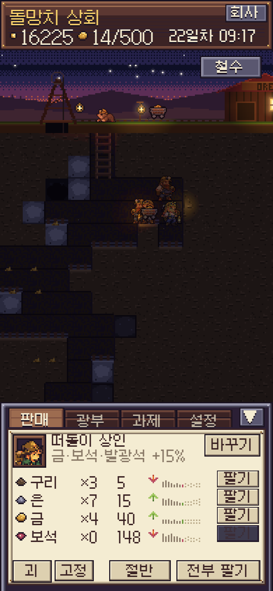
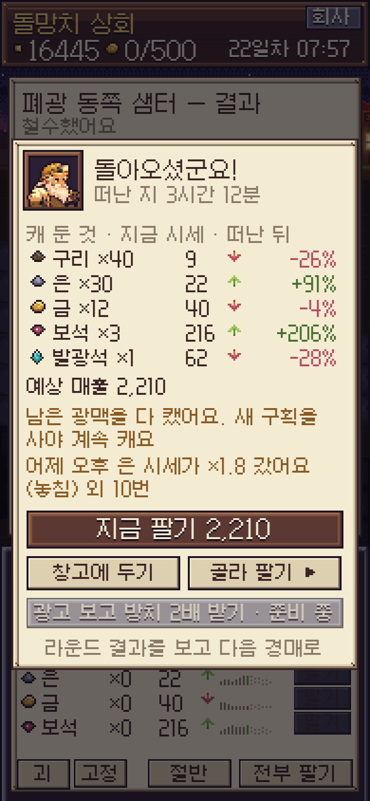
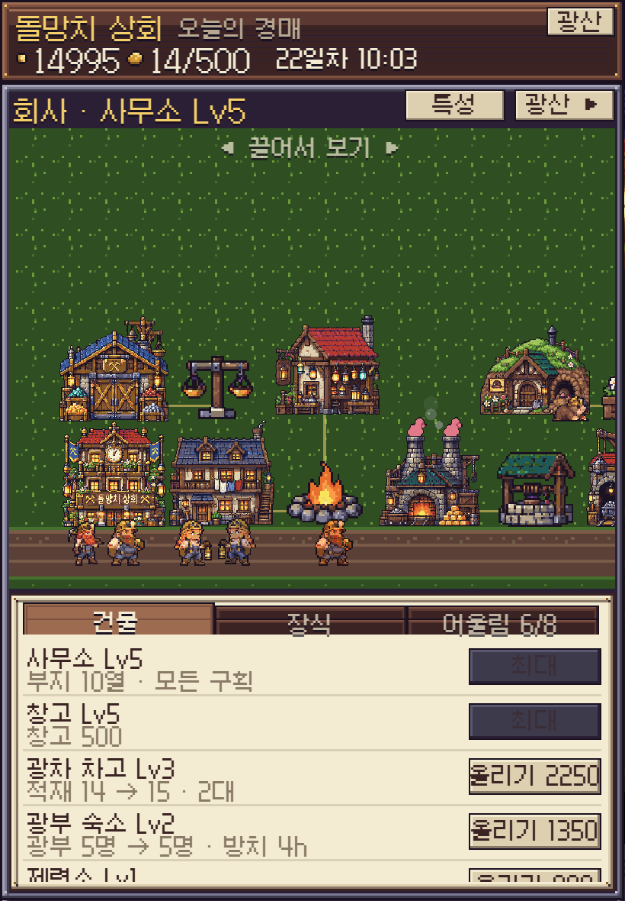
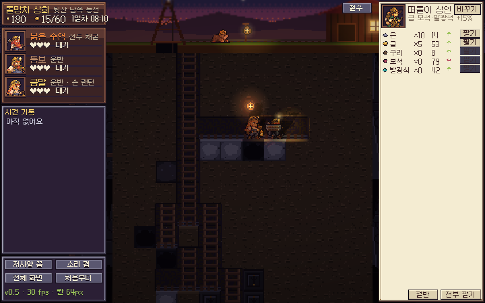
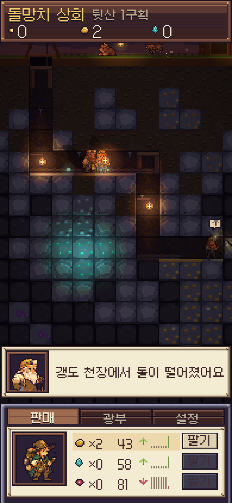
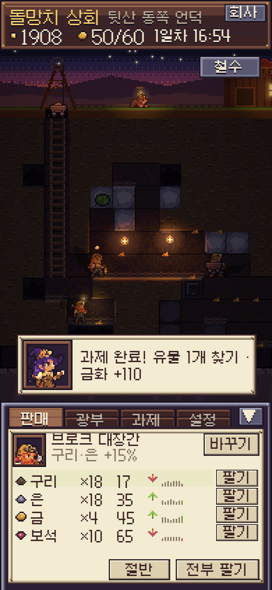
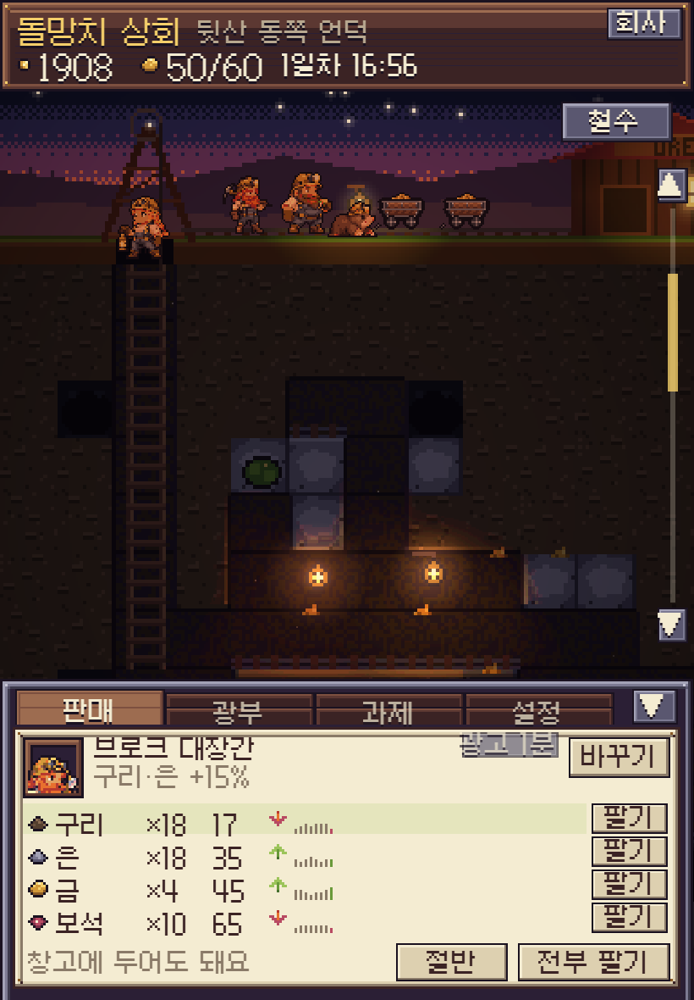
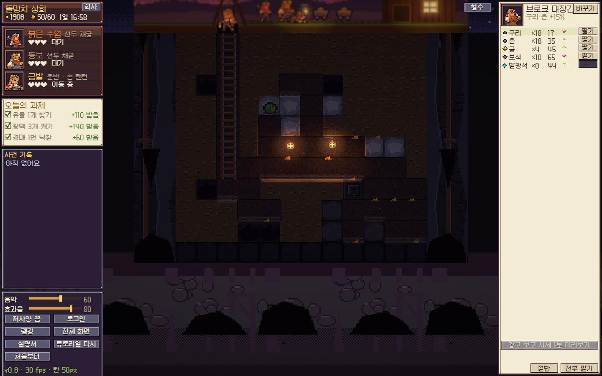

# 용사님, 채굴하실게요~ (Keep On Digging)

모험의 유산(체크인) 세계관 스핀오프 채굴 아이들러. 기획: [`docs/MINING_SPEC_1_1024.md`](docs/MINING_SPEC_1_1024.md) · [`docs/MINING_SPEC_2_LOOP_1024.md`](docs/MINING_SPEC_2_LOOP_1024.md) · [`docs/MINING_SPEC_3_IDLE_1024.md`](docs/MINING_SPEC_3_IDLE_1024.md) · [`docs/MINING_VISUAL_1024.md`](docs/MINING_VISUAL_1024.md) · 대사 [`docs/TEXT_GUILDS.md`](docs/TEXT_GUILDS.md) · 온보딩 [`docs/ONBOARDING_1024.md`](docs/ONBOARDING_1024.md).

**지금 단계: v0.6 — 방치 · 회사 · 특성 · 계정 (명세3).** v0.5 핵심 루프(경매 → 탐사 → 시추 → 광차 → 판매 → 결과) 위에, 앱을 닫아도 광부들이 캐 두고(「돌아오셨군요」), 라운드 사이에 회사를 키우고, 특성을 찍고, 체크인 계정으로 클라우드에 저장한다. 지하 호수·드워프 도시·광고 SDK는 명세4.

- 웹: https://essencead.github.io/keep-on-digging/  (`?low=1` 저사양 · `?ambient=0.4` 앰비언트)
- **숫자는 전부 [`src/balance.js`](src/balance.js)** — 시작 금화, 구획 값, 길드 성향, 칸별 뚫는 시간, 광차·창고, 중력, 사건, 시세, 별 기준…
- 저장: 브라우저 로컬(5초마다 + 닫을 때) · 로그인하면 Supabase `mine_saves`(라운드 끝·회사 변경·방치 정산·5분마다). [설정] → [처음부터]로 지움

## 화면
| 세로 폰 390×844 · 시추 | 세로 폰 · 돌아오셨군요 | 패드 820×1180 · 회사 | PC 1440×900 · 경매 |
|---|---|---|---|
| [](docs/screens/phone.png) | [](docs/screens/welcome.png) | [](docs/screens/pad.png) | [](docs/screens/pc.png) |
| 칸 = 너비/12 · 위 HUD(금화·창고·날짜·[회사]) · 아래 시트 판매/광부/과제/설정 | 떠난 동안 캔 광석 · 지금 시세·떠난 뒤 % · 놓친 급등 | 부지 한 칸 = 갱도 칸 ×2 · 잔디·흙길·울타리 · 넘치면 끌어서 봄 · 칸 선은 짓기·옮기기 중에만 · 밤엔 창문 빛 | 길드 대표 3명 + 대사 말풍선 · 낙찰 망치·도장 · 왼쪽 광부·과제·사건·설정 / 오른쪽 판매 |

## 한 라운드 (명세2 §2~§9)
| 단계 | 하는 것 |
|---|---|
| 경매 | 구획 카드 3장(이름·크기 S/M/L·힌트 2·시작가). [입찰] → +10/25/50% 또는 포기. 길드 3곳(공격적·신중·랜덤)이 평가액까지 따라옴 → 2라운드에 한 번 더 올릴 기회 → 낙찰. 놓치면 공짜 자투리 구획 |
| 탐사 15초 | 두더지가 지상을 걷다 아래 3칸 안 광맥 위에서 킁킁(클수록 오래). [투시 랜턴] 하루 2회: 톡한 곳 3×3이 2초 보임. 격자는 전부 가려진 흙 |
| 시추 | 0줄·뚫린 칸에서 손가락을 끌면 갱도 경로(주황 선 + 예상 초, 광부 발밑은 빨간 깜빡임). 못 뚫는 칸(단단한 바위·고대석)에서 빨간 X로 끊김. 붉은 수염이 차례로 파고, 세로로 판 칸엔 사다리. 광맥에 닿으면 덩어리 통째로(금색 테두리), 12칸↑ 대박 연출 |
| 광부 3 | 붉은 수염 = 선두 채굴 · 뚱보·금발 = 광석을 광차로 운반(머리 위 광석). 체력 ♥3, 0이면 지상에서 10초 쉼. [광부] 탭에서 상태 |
| 중력 | 발밑이 비면 멈칫 → 가속 낙하 → 착지(먼지·엉덩방아·"으악!"). 2칸↑ 기절 ★, 4칸↑ 기절 + 체력 −1. 막다른 구덩이면 사다리를 놓고 나옴. 광차가 떨어지면 적재 절반이 흩어지고 광부가 주워 담음 |
| 광차 | 뚫린 길에 레일 자동 부설 · 세로 갱은 도르래. 붉은 수염 근처에 서 있다가 8개 차거나 캘 게 없으면 지상 창고로. 창고 60 꽉 차면 지상에서 멈추고 광부들 팔짱 |
| 사건 | 붕괴(뚫린 칸 15↑, 20~60초) · 지하수(아래로 차오름, 걸음 ½, 광차 못 지남, [펌프 30]) · 가스(30초 정지·초록 가장자리, 랜턴을 2칸 안으로 끌면 폭발 3×3 + 체력 −1) · 동굴 슬라임(10%, 광차 길막 10초) |
| 판매 | 매입자 토글(브로크: 구리·은 +15% / 떠돌이 상인: 금·보석·발광 +15%, 나머지 −10%). 시세 10초마다 랜덤 워크(0.5~2.0, 평균 회귀). 하루 1~2번 모모 편지 30초 뒤 급등 ×1.8 40초(행 깜빡). [팔기] [절반] [전부 팔기] |
| 결과 | [철수](확인 시트) 또는 광맥 전부 고갈 → 낙찰가 → 매출 → **순이익** · 별 1~3(순이익/낙찰가 0.5/1.5/3.0) · 최대 광맥 · 시간 · 사건 · 할아범 한마디 → [다음 경매]. 누적 통계 저장 |
| 튜토리얼 | 첫 라운드만 모모 말풍선 6단계, 해당 행동을 하면 넘어감 |

## 비주얼 기준선 (v0.8 §5 — 매 배포 전 같은 장면을 나란히)
| v0.4 기준선 (세로 폰) | 지금 세로 폰 | 지금 패드 | 지금 PC |
|---|---|---|---|
| [](docs/screens/phone_v04.png) | [](docs/screens/cmp_phone.png) | [](docs/screens/cmp_pad.png) | [](docs/screens/cmp_pc.png) |
| 갱도 · 랜턴 · 발광 (안개 없음 — 프로토타입) | 갱도 · 들고 다니는 랜턴 + 벽 랜턴 · 안 판 칸은 안개(명세2) | 〃 | 〃 (패널 ≤ 35%) |

변환 손실 점검(원본 ↔ png2pxl ×4): `docs/preview/convert_check_*.png` (`py scripts/convert_check.py`). 길드 대표는 32×40에서 뭉개져 64×80으로 다시 변환.

## v0.9 (PATCH_V09 + v0.8-b)
| | 바뀐 것 |
|---|---|
| 인수인계 | 장면은 한 번만 만들고 대사 틀만 바뀜(넘길 때마다 다시 걸어오던 버그) · 탭 150ms 디바운스 · 붉은 수염은 처음 한 번 걸어 들어오고 숨쉬기 · 장부·열쇠는 2번째 줄에서 한 번 |
| 사무소 | GPT 원본 `art/raw/mine_office_interior.png` → png2pxl 256×224 (`sh scripts/office.sh` → `art/office/office_gpt.px.js`) · pxl은 벽난로 불꽃·램프·발광석·달빛·lighting(밤)만 · 할아범은 책상 뒤에 앉음(책상 앞판을 원본에서 잘라 덮음) · **정수 배율**(기기 픽셀 기준 4×·5×…, 남는 곳은 어두운 테두리) |
| 소리 | Howler · BGM 8곡(`sh scripts/bgm_build.sh` → mp3 128k + ogg) — 인수인계·설명서·튜토리얼 title · 회사 낮/밤 · 돌아오셨군요 밤 · 갱도 뒷산/폐광 · 경매 · 결과 · 대박(덕킹 −6dB 21초) · 루프 끝 3초 잘라내고 1.5초 크로스페이드 · 전환 1.5초 · 효과음 44종(`sh scripts/sfx_build.sh`) + 앰비언스 −18dB · 설정에 음악·효과음 슬라이더 · 첫 터치 전 무음 · 백그라운드 정지 (ffmpeg 없으면 ffmpeg-static) |
| 경매 시작가 | 예상 가치 중간값 × 0.35 (크기별 기본가보다 낮게는 안 감) — 길드 한도(0.45~0.8)까지 몇 번이면 닿음 |
| §5 | PC 좌우 패널 합 ≤ 35%(UI 배율 1.5) · 뚫린 가로 갱도에 벽 랜턴이 저절로 걸림(빛 웅덩이) · 조명은 월드 단위라 칸 크기에 비례 · 앰비언트 0.4 고정 |

## v0.8 (PATCH_V08 §1~4)
| | 바뀐 것 |
|---|---|
| 화면 | PC·가로 패드: 칸 = min(높이/18, 너비/12) — 격자 16줄이 한 화면 (지상 1.6칸) · 휠은 넘칠 때만. 세로 폰: 그릴 수 있는 칸(지상 줄·뚫린 칸·그 옆)에서 끌면 갱도, 그 밖은 화면 끌기 · 두 손가락은 늘 끌기 · 격자 오른쪽 스크롤 막대 + ▲▼(6줄씩) · 손 댄 칸 테두리 반짝 |
| 진행 | 광차 기본 2대(차고 Lv3 3대 · Lv5 4대) · 3칸/초 · 적재 10 · 선두 2명(붉은 수염·뚱보)이 같이 캐고 금발이 운반 · 흙 0.45 · 바위 1.2 · 광맥 0.8초 · 광차가 선두 옆까지 들어와 바로 받음 · 캘 게 없으면 광차가 흩어진 더미를 주움 · 운반 광부는 광차가 없으면 직접 지상까지 · 광맥 총량 +30% |
| 경매 | 텀오일식: 카드마다 예상 가치(±25%, 특성 탐사 4면 ±10%) + 이익 막대 · [올리기 +10%] 하나 + [포기] · 길드가 0.4초 안에 따라오거나 포기 · 2초 동안 아무도 안 따라오면 3·2·1 낙찰 · 길드 머리 위에 각자 호가 |

## 온보딩 (v0.7 · ONBOARDING_1024)
| | 하는 것 |
|---|---|
| [0] 인수인계 | 첫 실행: 사무소 장면(낮 빛) · 할아범 대사 4 · 붉은 수염이 걸어 들어옴 · 열쇠·장부가 밀려옴 · [건너뛰기]. **v0.6 이전 세이브는 이것만 보고 넘어감** |
| [1] 튜토리얼 라운드 | 고정 구획 뒷산 비탈(할아범 선물) · 12단계 강제: 강조한 곳만 밝게, 나머지 어둡게(입력도 막음) · pxl 손가락(가리키기·누르기·끌기) · 모모 한 문장 · 20초면 말풍선 깜빡 · 다른 경로는 여기요!. 사건·낙하·체력·급등·과제 편지·회사 버튼 없음, 구리 시세는 오르는 중 |
| [2] 첫 경매 | 할아범 안내 3줄(탭) · 첫 경매 구획 하나는 S · 힌트 2 · 시작가 120 |
| [3] 처음 만나는 순간 | 회사(손가락: [회사] → 창고 [짓기]) · 지하수 · 가스 · 붕괴 · 낙하 · 급등 편지 · 창고 가득 · 돌아오셨군요 · 특성 포인트 · 대박 — 각 1회 대사 카드 · 칸 종류 첫 등장 라벨 |
| 첫 화면 | 튜토리얼 뒤엔 접속하면 부지 + 깜빡이는 [오늘 경매 준비됐어요 ▶] (라운드 중이면 갱도) · 경매 고정 안내줄 · 시추 안내줄(3라운드까지) |
| 설명서 | [설정] → [설명서] 11쪽 (체크인 manual 모양) · [설정] → [튜토리얼 다시] |

## 명세3 (v0.6)
| | 하는 것 |
|---|---|
| 방치 | [철수]한 구획의 남은 광맥을 광부들이 현실 시간으로 캔다: 분당 광부 수 × 곡괭이 × 0.5칸. 상한 4h(숙소 Lv3 6h · Lv5 8h) · 창고 남은 칸 · 남은 광맥. 라운드 중에 닫으면 그 라운드는 멈춰 있음 |
| 돌아오셨군요 | 1분↑ 떠났다 오면 카드: 캔 것 · 지금 시세 · 떠난 뒤 % · 예상 매출 · [지금 팔기] [창고에 두기] [골라 팔기 ▸](판매 행 하이라이트) · 놓친 급등 · [광고 2배](준비 중) |
| 시세 | 결정론적 랜덤 워크(틱 번호·광종 해시). 시세 시계는 현실 시간이라 떠나 있던 동안 최대 24시간 빨리감기 · 게임 날짜는 접속 중에만 흐름 |
| 회사 | HUD [회사] · 결과 [회사로]. 건물 9(사무소·창고·광차 차고·숙소·제련소·랜턴 공방·펌프실·포탑 공방·두더지 집) Lv1~5 즉시 · 다른 건물 Lv ≤ 사무소 · 장식 6 · 어울림 8(숨은 2, 체크인 harmony gap 규칙). 라운드 중엔 보기만 |
| 효과 | 창고 60→500 · 광차 2대(차고 Lv3)·적재·속도 · 광부 3→6 · 제련(괴 ×1.6, 시세 변동 ½, 판매 탭 [괴]) · 투시 랜턴 횟수·5×5 · 펌프 값·자동 · 포탑(슬라임 1·박쥐 2) · 탐사 시간·킁킁 깊이·크기 점 · 사무소 Lv2 L 구획 · Lv3 폐광 |
| 특성 | 회사 화면 [특성]: 탐사·채굴·장사 × 5단, 사무소 Lv당 1점 + ★3 10회마다 1점 · 초기화 500(사무소 Lv1 때 1회 무료) |
| 계정 | [설정] → [로그인]: 체크인(모험의 유산) 아이디·비밀번호 그대로, 같은 사이트라 체크인에 로그인돼 있으면 자동. 클라우드가 더 진행됐으면 고르기. 비밀번호 찾기 = 복구 코드 |
| 랭킹 | [설정] → [랭킹]: 주간(월요일 0시 KST) 순이익 · 최대 광맥 · 유물. 기록은 `submit_mine_rank`로만(이번 주·범위 검사·큰 값만) |
| 경매 연출 | 길드 대표 3명(`art/raw/mine_chibi_guilds.png` → png2pxl) · 등장/호가/패스/낙찰 대사(TEXT_GUILDS) · 호가 = 몸 흔들, 패스 = 고개 젓기 + 회색 · 낙찰 = 망치 쾅 + 도장 · 세로 폰은 호가 버튼이 아래 시트 |
| 폐광 2층 | 사무소 Lv3: 카드 셋 중 하나. 은·금 많음 · 단단한 바위 2배 · 동굴 2배 · 유물 2배 · 시작가 ×1.6 · 청록 · 박쥐떼(근처 광부 1.5초 기절) |
| 일일 과제 | 한국 0시마다 12종 중 3개(모모 편지) · 금화 50~150 자동 · [과제] 탭(PC 왼쪽) · 결과 카드에 n/3 |

## 구조
- `src/balance.js` 숫자(명세3: `idle` · `company` · `abandoned` · `daybook` · `talents`) · `src/save.js` 로컬 저장(v2 · migrate) · `src/offline.js` 방치 정산 · `src/company.js` 회사·어울림·특성 효과 · `src/daybook.js` 일일 과제 · `src/net.js` 계정·클라우드·랭킹 · `src/text.js` 대사 · `src/onboard.js` 온보딩 대사·튜토리얼 구획·안내·설명서(진행 엔진은 main.js) · `supabase/mine.sql` 테이블 메모 · `src/gen.js` 구획 생성(힌트 → 칸, 층·광맥·동굴·유물·지하수·가스) · `src/market.js` 시세 · `src/rng.js` 시드 난수
- `src/main.js` 장면·상태 기계·경매·탐사·시추·광차·사건·결과·UI · `src/ui.js` UI 킷 런타임(9-slice) · `src/gl.js` 조명·후처리 · `src/sound.js` 효과음
- 아트 (`npm run art`): `art/shaft.px.js` 타일·소품(형철 초안 + Code 추가: 고대석·지하수·가스·유물·동굴·사다리·빨간 X·슬라임) · `art/chibi.px.js` 캐릭터(+ 길드 대표 3) · `art/buildings_gpt.px.js` 회사 건물·장식(GPT 시트 `art/raw/mine_buildings_lv1·3·5.png` → `sh scripts/buildings.sh` → 128×128, Lv2·4는 1·3 그림) · `art/yard.px.js` 부지 배경(잔디·흙길·울타리·하늘) · `art/buildings.px.js` 폴백(형철 코드 그림) · `art/chars.px.js` 광차(형철, §9) · `art/fx.px.js` 이펙트 10종 · `art/mine.px.js` 지상·겹·아이콘·힌트 아이콘 · `art/ui/ui.px.js` UI 킷 · `art/office/office.px.js` 사무소
- 렌더: 알베도 + 노멀 → 조명 셰이더 → 발광·헤일로 → 후처리 → 확대 (화면 1px = 칸/32: 타일 2×2, 캐릭터·이펙트 1:1), 그 위에 UI

## 명령
```bash
npm install
npm run dev          # 로컬
npm run art          # 아트 다시 굽기
npm run portraits    # 흉상 초상 다시 뽑기
sh scripts/chibi.sh  # 치비 4장 → art/conv/*.txt
npm run deploy       # gh-pages 배포
```
스크린샷: `npm run dev` 상태에서 브라우저 콘솔 `await __kod.shot('phone')` → `docs/screens/phone.png` (dev 서버에서만 저장).
